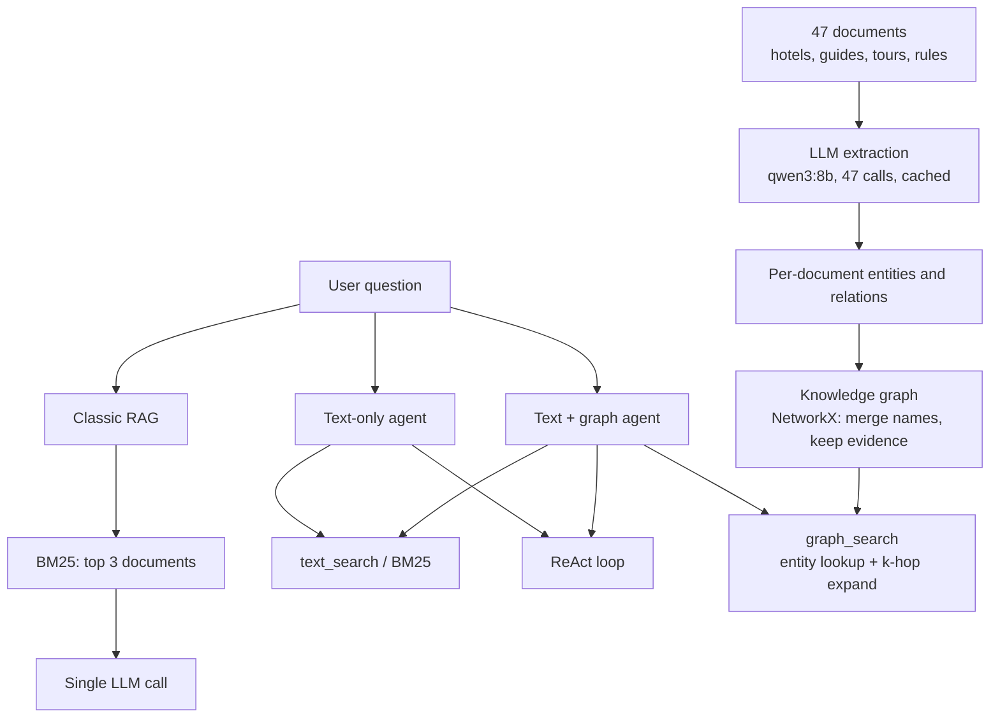

# Local GraphRAG Agent

A local comparison of **classic RAG**, a **text-only ReAct agent**, and a **graph-search agent** on a synthetic travel-agency knowledge base. An LLM reads 47 documents, extracts entities and relations into a knowledge graph, and an agent can search either the graph or the raw text. Everything runs on a laptop through [Ollama](https://ollama.com) (`qwen3:8b`) and the OpenAI-compatible API at `http://localhost:11434/v1`. No cloud API key is required.

The graph helps most on two-hop questions (excursion → guide → languages), where BM25 often returns only one of the documents in the chain. On three-hop questions the graph did not help in this run, because the 8B model dropped almost all `говорит_на` (speaks) edges during extraction.

## Architecture



## Three approaches

| Approach | How it answers | Typical cost in this run |
|---|---|---|
| **Classic RAG** | One BM25 retrieval, one LLM call | 1 LLM call, 1 text retrieval per question |
| **Text-only agent** | ReAct agent with `text_search` only | 2.5 LLM calls, 1.5 text retrievals on average |
| **Text + graph agent** | Same agent plus `graph_search` over the extracted graph | 2.3 LLM calls, 1.0 graph + 0.3 text calls on average |

Building the graph is a one-off cost of **47 LLM calls** (one per document).

The graph schema has 6 entity types (city, hotel, excursion, guide, language, tour) and 7 relations, including `ведёт` (guide leads excursion), `говорит_на` (guide speaks a language), `включает` (tour includes excursion), and `стартует_от` (excursion starts at a hotel). Entity resolution merges short names from the documents (`Сафин`, `Алия`, `Петроградка`) with the full node names.

## How to run

**Requirements:** Python 3.10+, [Ollama](https://ollama.com) running locally.

```bash
# 1. Model
ollama pull qwen3:8b

# The saved results used a 16k-context copy of this model (documents are long).
# Optional but recommended if you want to match the notebook outputs:
printf 'FROM qwen3:8b\nPARAMETER num_ctx 16384\n' > Modelfile
ollama create qwen3-hw -f Modelfile
rm Modelfile

# 2. Python environment
python -m venv .venv
source .venv/bin/activate   # Windows: .venv\Scripts\activate
pip install -r requirements.txt

# 3. Run the notebook
jupyter notebook graphrag_comparison.ipynb
# or: jupyter lab graphrag_comparison.ipynb
```

Then **Run All**. The notebook talks to `http://localhost:11434/v1` and uses the model name `qwen3-hw` by default. The client library expects an `api_key` string; the placeholder `"ollama"` is not a real secret.

To use a different local model:

```bash
export LLM_BASE_URL=http://localhost:11434/v1
export LLM_MODEL=qwen3:8b
```

The first run writes `graph_extraction.json` (cached extractions). Later runs reuse it unless you set `REEXTRACT = True`. Graph extraction plus the 10-question comparison takes a while on an 8B model; the cache avoids repeating the 47 extraction calls.

## Results

Numbers below are from a local run of this notebook with Ollama `qwen3-hw` (`qwen3:8b`, `num_ctx=16384`), temperature 0. They are the figures printed in the comparison cell of `graphrag_comparison.ipynb`. Evaluation is on 10 of the 24 questions, grouped by hop count.

### Overall (10 questions)

| System | facts_recall | citation_ok | honest | graph_calls | text_calls | llm_calls |
|---|---:|---:|---:|---:|---:|---:|
| Classic RAG | 0.62 | 0.89 | 0.0 | 0 | 1.0 | 1.0 |
| Text-only agent | 0.56 | 1.0 | 0.0 | 0 | 1.5 | 2.5 |
| Text + graph agent | **0.8** | **1.0** | **1.0** | 1.0 | 0.3 | 2.3 |

`honest` is only scored on the one question whose answer is not in the database (q21, a Japanese-speaking guide). Only the graph agent was marked honest by the metric (see limitations below).

### facts_recall by hop count

| Group | Classic RAG | Text-only agent | Text + graph agent |
|---|---:|---:|---:|
| 1 hop (q03, q05) | 1.0 | 1.0 | 1.0 |
| 2 hops (q07, q10, q13) | 0.67 | 0.28 | **1.0** |
| 3 hops (q15, q16, q17, q19) | 0.4 | 0.54 | 0.54 |

### What the graph looked like after extraction

- Merged graph: **55 nodes, 95 edges**.
- Relations that matched the document counts exactly: `стартует_от` 12, `ведёт` 15, `проживание_в` 7, `включает` 11; 12 hotels, 15 excursions, 5 tours after merge.
- Under-extracted: only **4** `Язык` entities and **4** `говорит_на` edges (about 25 language edges are present in the guide cards).
- Over-extracted: `работает_в` 16 (expected 11), `находится_в` 30 (expected 27); 7 city nodes (expected 6) and 12 guide nodes (expected 11), plus an isolated node `агентство`.
- 26 relations were dropped by the parser: 24 because the relation endpoint was missing from the entity list (almost all of them `говорит_на`), 1 wrong endpoint type, 1 reversed direction.

### Key findings

- The graph is clearly useful on **two-hop** questions (facts_recall 1.0 vs 0.67 RAG and 0.28 text-only). In q07 the text agent read only the excursion card and reported a single language (0.33); one `graph_search` walk (excursion → guide → languages) was enough. In q13 both RAG and the text agent named the wrong excursion (0.00); the graph found the correct one (1.00). Short names in the cards are already merged into full nodes, which is what makes the walk work.
- On **three-hop** questions the graph had **no advantage** (0.54, same as the text agent; RAG 0.4). Almost all `говорит_на` edges were lost at extraction time, and the graph agent rarely checked the text (0.3 `text_search` calls on average). For q15, classic RAG actually scored highest (0.75 vs 0.50). For q19 all three systems scored 0.00.
- Cost: RAG is cheapest (1 LLM call per question). The graph agent was slightly cheaper than the text-only agent (2.3 vs 2.5 LLM calls; 1.3 vs 1.5 tool calls), plus the one-off 47 extraction calls. For a base like this, a graph agent is a reasonable default if extraction is improved and the prompt forces a text fallback when the subgraph is incomplete. Simple one-hop questions are fine with classic RAG.

## What I learned / limitations

- **Small local models miss relations.** `qwen3:8b` often wrote a valid `говорит_на` triple but did not list the language in `entities`. The parser then dropped the edge (`конец связи не среди сущностей`). That is a model error, but the check is also strict: the target of `говорит_на` can only be a language, so the entity could have been inserted automatically. This single failure mode hurt q15, q17, and q19.
- **Extraction can also invent edges.** Extra `работает_в` / `находится_в` links were justified with quotes that do not actually support the relation (for example a meeting-point sentence used as evidence that a guide works in a city).
- **Metrics are imperfect.** The text-only agent’s q21 answer was an honest “there is no Japanese-speaking guide in the database,” but `has_no_info` only looked for phrases such as `нет в базе` / `нет информации` and missed `в базе нет`, so `honest` was recorded as 0. The graph agent’s q10 score of 1.00 may be a false positive: the graph has no “Safin speaks German” edge, and the scorer may have matched the substring `говорит` in `говорит по-русски`.
- **An incomplete graph can mislead the agent.** When language edges were missing, the graph agent sometimes trusted the subgraph and did not open the guide cards (q15 even fabricated a quote). A production prompt should forbid answering from missing graph attributes and should require a `text_search` fallback.

## Repository layout

```
graphrag_comparison.ipynb   # full pipeline, with outputs from the local run
travel_agency_data.json     # 47 documents, graph schema, 24 evaluation questions
requirements.txt
```

Running the notebook creates `graph_extraction.json` (extraction cache). It is gitignored because it is a generated artifact and can be rebuilt.

## Note on publishing

This project started as coursework. Before you push it to a public GitHub repository, confirm that the course allows publishing solutions. If it does not, keep the repository private, or rewrite the framing and wait until the course says public solutions are allowed.

---

## 中文说明

这是一个本地的 GraphRAG 对比实验：用本地 Ollama 上的 `qwen3:8b` 从 47 篇虚构旅行社文档里抽取知识图谱，再比较经典 RAG、纯文本 ReAct agent，以及带 `graph_search` 的 agent。

**怎么运行：** 安装 [Ollama](https://ollama.com) 并执行 `ollama pull qwen3:8b`。建议再做一个 16k 上下文的 `qwen3-hw`（本仓库保存的结果就是用它跑的），命令见上文英文部分。然后 `pip install -r requirements.txt`，打开 `graphrag_comparison.ipynb`，从头运行全部单元格。默认请求 `http://localhost:11434/v1`，不需要云端 API key。第一次抽取会调用模型 47 次，结果缓存到 `graph_extraction.json`。

**主要结果（来自笔记本里已保存的本地运行输出，不是估的）：** 10 道题上，带图 agent 的 facts_recall 是 **0.8**，经典 RAG 是 0.62，纯文本 agent 是 0.56。优势集中在 2 跳问题上（1.0 对 0.67 / 0.28）；3 跳问题上图没有更好（都是 0.54），因为 8B 模型几乎把 `говорит_на`（导游会说的语言）这条边抽丢了（只剩 4 条，文档里大约有 25 条）。指标也有局限：纯文本 agent 在“库里没有日语导游”这题其实答得很诚实，但正则没匹配到「в базе нет」，`honest` 被记成了 0。

公开到 GitHub 之前，请确认课程是否允许公开作业解答。
